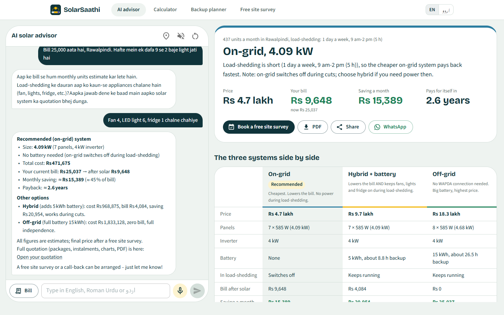
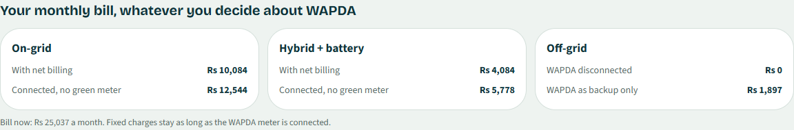
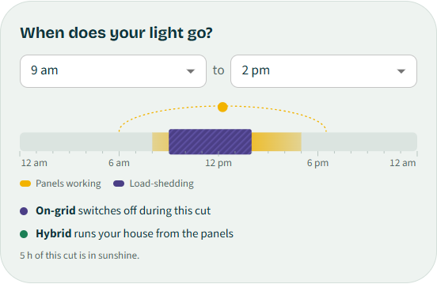
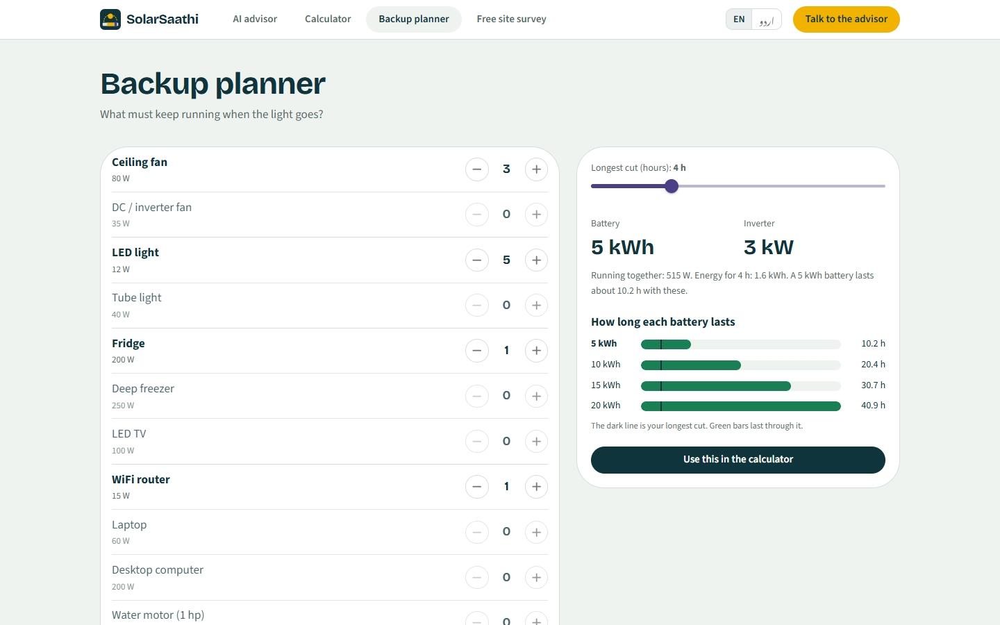
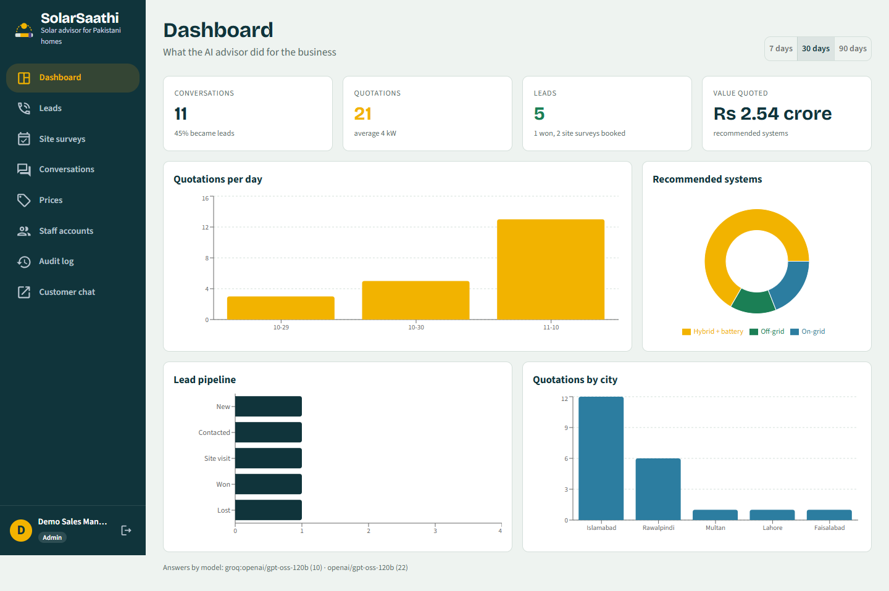
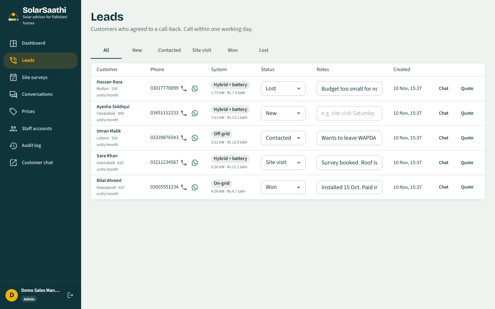
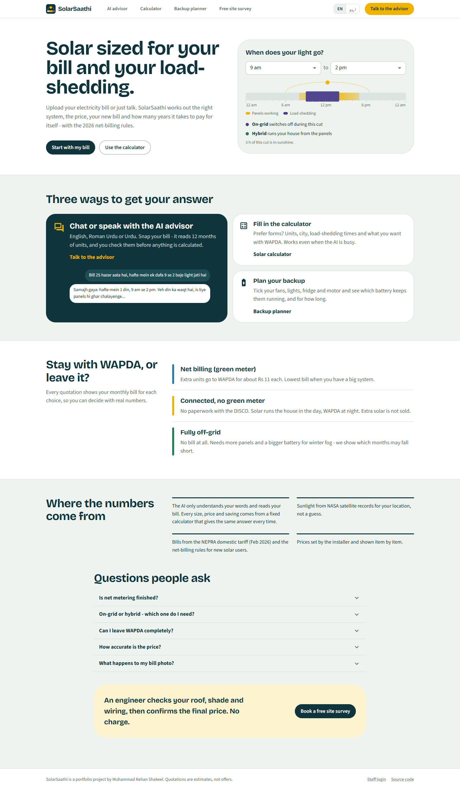
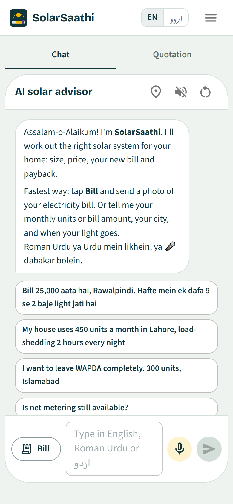

# ☀️ SolarSaathi: AI Solar Sizing Agent for Pakistan

       

An **AI agent** that does a solar salesperson's first job. A home owner uploads a photo of their electricity
bill or **talks to it in Urdu or English**. The agent reads the bill, asks about load-shedding, **calls a sizing
tool** and gives three options (on-grid, hybrid, off-grid) with price, monthly saving, payback and a **PDF
quotation**. If the customer agrees, it saves a lead for the installer's sales team.

> Built only with **free** models: Groq (chat + Whisper voice) with Google Gemini as automatic backup and for reading bill photos.

## 📸 Screenshots

| AI advisor (Roman Urdu) + live quotation | Your bill for every WAPDA choice |
|---|---|
|  |  |
| **Load-shedding timing decides the system** | **Backup planner** |
|  |  |
| **Installer dashboard** | **Leads pipeline** |
|  |  |
| **Home page** | **On a phone** |
|  |  |

More: [calculator](docs/screenshots/06_calculator.png) · [Urdu](docs/screenshots/03_home_urdu.png) ·
[site survey](docs/screenshots/10_site_survey.png) · [conversations](docs/screenshots/14_staff_chats.png) ·
[prices](docs/screenshots/15_staff_prices.png) · [phone quotation](docs/screenshots/18_phone_quote.png)

> Customers in the screenshots are demo data (`backend/scripts/demo_data.py`), not real people.

## ✨ Features

| | |
|---|---|
| 🤖 **Tool-using agent** | LangGraph loop: the model decides which of 7 tools to call (bill estimate, appliance load, sizing, prices, save contact, book site survey) |
| 🧾 **Reads your bill photo** | Gemini vision + a strict JSON schema: 12 months of units, sanctioned load, DISCO. **The customer checks and corrects the numbers before the AI uses them.** No name / address stored, photo not saved |
| 🎤 **Voice in Urdu & English** | Whisper (Groq) speech-to-text, browser text-to-speech; Roman Urdu and Urdu script supported |
| ⚖️ **3 options, real maths** | on-grid / hybrid / off-grid sized month by month with the **NEPRA 2026 tariff and net billing** (~Rs 11 export) |
| 🕘 **Real load-shedding schedules** | "once a week, 9 am to 2 pm" or "2 hours every night": daytime cuts switch on-grid off, night cuts size the battery |
| 🔌 **Every WAPDA choice** | the bill with net billing, connected without a green meter, fully off-grid, or WAPDA as backup only |
| 🛰️ **NASA sunlight** | monthly solar output from NASA POWER satellite data for the customer's city or exact location (city table if offline) |
| 🔋 **Backup planner** | tick fans, lights, fridge, motor… → battery + inverter size and how long each battery lasts |
| 📦 **Packages & instalments** | Economy / Standard / Premium prices and 12-36 month instalments compared with the monthly saving |
| 📅 **Free site survey booking** | from the website or by asking the agent; staff confirm it on the Site surveys page |
| 🌐 **English / اردو** | the website switches to Urdu (Nastaliq) |
| 🚫 **No invented numbers** | every price comes from tested Python tools, and an evaluation checks the agent's answers for made-up numbers |
| 📄 **PDF quotation + share link** | price breakdown, usage-vs-solar chart, WhatsApp share |
| 🔁 **Automatic model backup** | Groq busy or down → Gemini answers (`with_fallbacks`); a busy or retired Gemini model → the next free Gemini model |
| 🧮 **Quick calculator** | the same engine as a plain form: works with no AI at all |
| 🧑‍💼 **Installer dashboard** | leads pipeline, call / WhatsApp buttons, every conversation with the tools used, editable price list |
| 📱 **Android app + PWA** | Capacitor app with mic and camera; installable website |
| 🔐 **Secure** | roles, lockout, rate & quota limits, prompt-injection rules, upload checks, audit log |

## 🧠 How it works

```
Customer ─ text / voice / bill photo ─► FastAPI ─► LangGraph agent ◄─► tools (Python maths, SQL Server)
                                           │            │
                              Whisper (Groq)      LLM: Groq ──fallback──► Gemini
                              Gemini vision (bill)
```

```
START → agent ──tool call──► tools ──result──► agent → … → END (answer + quotation)
```

Full explanation: [docs/HOW_IT_WORKS.md](docs/HOW_IT_WORKS.md) · Changing things: [docs/WHERE_TO_CHANGE.md](docs/WHERE_TO_CHANGE.md) ·
Interview prep: [docs/INTERVIEW_NOTES.md](docs/INTERVIEW_NOTES.md)

## 🛠 Tech stack

| Part | Tech |
|---|---|
| Agent | LangGraph, LangChain tools, Groq (`openai/gpt-oss-120b`), Gemini 2.5 Flash (backup + vision), Whisper large-v3-turbo |
| Backend | Python 3.11, FastAPI, Pydantic, pyodbc, ReportLab |
| Database | Microsoft SQL Server (own `SolarSaathi` database) |
| Frontend | React 18, Vite, Redux Toolkit, Material UI, Recharts |
| Mobile | Capacitor (Android), PWA |
| Quality | pytest (no DB / no key needed: scripted model), agent evaluation, GitHub Actions, gitleaks, pip-audit |

## 🚀 Run it on Windows

1. Install Python 3.11, Node.js 20, SQL Server (Express is fine) and *ODBC Driver 17 for SQL Server*.
2. Get two free keys: [Groq](https://console.groq.com/keys) and [Google AI Studio](https://aistudio.google.com/apikey).
3. Double-click **`setup_project.bat`**: it installs everything, asks for your SQL Server name and your keys
   (typed hidden, saved only in `backend\.env`), creates the database and your admin account.
4. Double-click **`start_project.bat`** → customer chat at http://localhost:5175, staff at http://localhost:5175/staff.
5. On your phone (same Wi-Fi): **`start_phone.bat`** (https, so the microphone works).

| Helper (`scripts\windows`) | |
|---|---|
| `capture_screenshots.bat` | adds demo customers and retakes all screenshots (app must be running) |
| `update_app.bat` | after copying a new version: database upgrade + new packages |
| `run_tests.bat` | all automated tests |
| `check_ai_keys.bat` | checks your keys and lists the models they can use |
| `run_agent_eval.bat` | scores the real agent on 10 scripted customers |
| `update_github.bat` | upload changes |

## 📂 Project structure

```
backend/
  app/agent/       graph.py (LangGraph), tools.py, prompts.py, llm.py (Groq + Gemini backup)
  app/services/    sizing.py, tariff.py, prices.py, bill_reader.py, voice.py, quote_pdf.py, store.py
  app/routes/      chat (customers), quotes, auth, admin
  scripts/         schema.sql, init_db.py, setup_env.py, check_ai.py
  tests/           tests with a fake database and a scripted model
frontend/src/      pages (Chat, Calculator, Quote, staff/*), components (QuoteView, VoiceButton, …)
evaluation/        eval_agent.py
docs/              HOW_IT_WORKS, WHERE_TO_CHANGE, INTERVIEW_NOTES
```

## ⚠️ Limitations

* Prices, tariffs and the net-billing rate are October 2026 estimates; the installer updates prices on the Prices page.
  FPA / QTA fuel adjustments are not included in bill estimates.
* Free AI tiers have daily limits; the quick calculator keeps working without them.
* Solar yield per city is an average; shading and roof direction are checked at the site survey.
* Portfolio project: quotations say so and are not real offers.

## 👤 Author

**Muhammad Rehan Shakeel**: [GitHub](https://github.com/MuhammadRehanShakeel)
